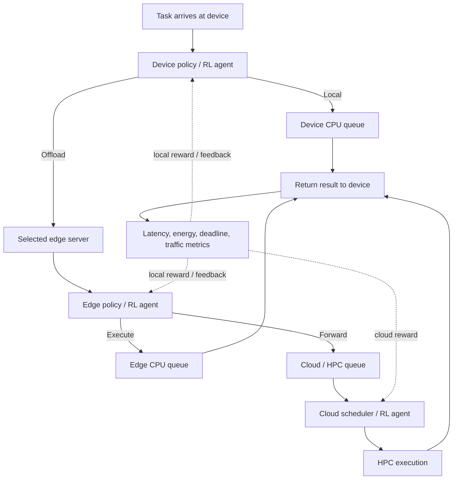

# System architecture

The simulator represents one task moving through three decision levels. The
default topology remains one device, one edge server, and one cloud node for
backward compatibility. `TopologyConfig` can instead define multiple devices,
multiple edges, and a fixed device-to-edge association while all edges share
one cloud scheduler.

The reproducible topology demonstration uses three devices, two Edge servers,
and one shared Cloud worker. The Alibaba/RL reference experiments use the
versioned topology in `configs/alibaba-multi-topology.yaml`: 24 devices, three
Edge servers, and one shared Cloud worker. In both cases, the Cloud scheduler
has one modeled execution slot; a multi-worker HPC cluster is outside the
current scope.



## One-task lifecycle

```text
arrival
  |
  v
[device policy]
  | local ----------------------> [device queue] ----\
  |                                                   |
  | offload                                          v
  +---------------------------> [device-edge link] -> [edge policy]
                                                      | edge
                                                      v
                                               [edge queue/CPU]
                                                      |
                                                      | cloud
                                                      v
                                           [edge-cloud link] -> [cloud queue]
                                                                    |
                                                                    v
                                                               [cloud CPU]
                                                                    |
                 result transfer <---------------------------------+
                                  |
                                  v
                  [latency, energy, deadline, traffic metrics]
```

Every queue contributes waiting time. Every modeled link contributes
serialization time, propagation time, and resource queue time. The result
returns to the device before the task is marked complete.

`execution_start_time_s` is the timestamp at which the selected compute
resource is acquired and computation begins. For a queued task it is later
than arrival time; the difference is compute-resource waiting time. This field
is used to verify FIFO and EDF dispatch order and is distinct from
end-to-end completion time.

## Validation scenarios

The default development smoke workload is intentionally small and regular. It
does not reliably make greedy placement switch decisions or create different
EDF/FIFO orders. Two separate configurations test those behaviors:

- `configs/greedy-switch.yaml`: a large, slow upload favors local execution,
  while a small upload favors edge execution.
- `configs/cloud-contention.yaml`: a long first cloud task blocks later tasks,
  and different deadlines force EDF and FIFO to choose different queued jobs.

Run them with:

```bash
python scripts/run_scenario_validation.py configs/greedy-switch.yaml
python scripts/run_scenario_validation.py configs/cloud-contention.yaml
```

## Configurable topology

The demonstration topology contains:

```text
device-1 ─┐
device-2 ─┼──> edge-1 ─┐
device-3 ─┘           ├──> one shared Cloud worker
                       └──> edge-2
```

The Alibaba/RL reference topology scales the same ownership model to 24
devices associated with three Edge servers. Each device owns a CPU resource
and battery ledger. Each Edge owns a CPU resource, queue, and device/Cloud
links. Devices may share an Edge queue. Cloud jobs carry the originating Edge
ID, so one scheduler can compare jobs from all Edge servers. The association
is configured explicitly; the device policy can only choose local execution
or its assigned Edge.

## Decision boundaries

- Device chooses only local execution or a nearby edge. It does not directly choose cloud.
- Edge chooses only edge execution or cloud/HPC forwarding.
- Cloud schedules the tasks that arrive from edge nodes.
- Each agent sees only its permitted local observation plus deliberately defined feedback fields. Do not pass global state to lower agents in the hierarchical variant.
- Model device-edge and edge-cloud links separately, including uplink and result-return/downlink traffic if available.
- Feedback messages are delivered with modeled serialization and propagation
  delay, but do not reserve the data-plane link or block task execution. This
  preserves causal feedback timing without modeling full control/data-plane
  network contention.
- A deadline is a duration from arrival, not an absolute timestamp in the input.
- The current workload contains independent tasks. DAG tasks are not yet
  implemented.

## Cloud action space

For a fixed discrete DQN action space, the cloud agent chooses a queue discipline at a dispatch point:

- `0`: EDF
- `1`: Shortest Processing Time
- `2`: FIFO

This is a learned selection among scheduling rules. It is not arbitrary selection by task ID. Report that distinction accurately.

## Training strategy

1. Train each agent in a controlled environment while the other tiers use fixed policies.
2. Evaluate each frozen agent in the complete hierarchy.
3. Optionally fine-tune/alternate training to investigate interaction and non-stationarity.
4. Compare all methods on matching scenarios, workloads, resource capacities and evaluation seeds.

This is a practical training schedule, not a proof of global optimality.
