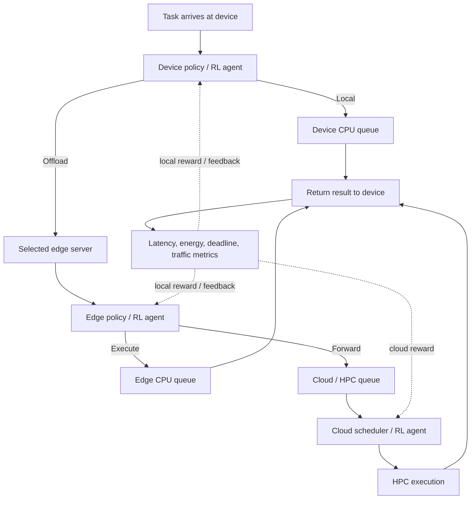

# System architecture — initial proposal

## Decision boundaries

- Device chooses only local execution or a nearby edge. It does not directly choose cloud.
- Edge chooses only edge execution or cloud/HPC forwarding.
- Cloud schedules the tasks that arrive from edge nodes.
- Each agent sees only its permitted local observation plus deliberately defined feedback fields. Do not pass global state to lower agents in the hierarchical variant.
- Model device-edge and edge-cloud links separately, including uplink and result-return/downlink traffic if available.
- A deadline is a duration from arrival, not an absolute timestamp in the input.
- Begin with independent tasks. DAG tasks are optional unless required by the professor.

## Cloud action-space proposal

For a fixed discrete DQN action space, the cloud agent chooses a queue discipline at a dispatch point:

- `0`: EDF
- `1`: Shortest Processing Time
- `2`: FIFO

This is a learned selection among scheduling rules. It is not arbitrary selection by task ID. Report that distinction accurately.

## Training strategy

1. Train each agent in a controlled environment while the other tiers use fixed policies.
2. Evaluate each frozen agent in the complete hierarchy.
3. Optionally fine-tune/alternate training to investigate interaction and non-stationarity.
4. Compare all methods on matching scenarios, workloads, resource capacities and evaluation seeds.

This is a practical training schedule, not a proof of global optimality.
