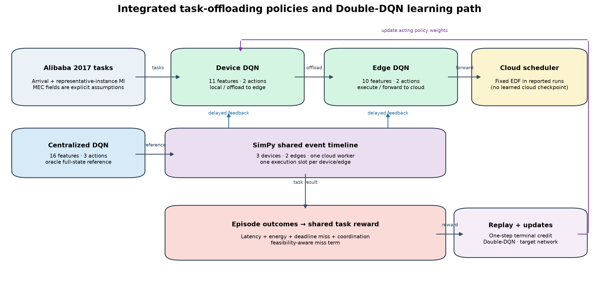
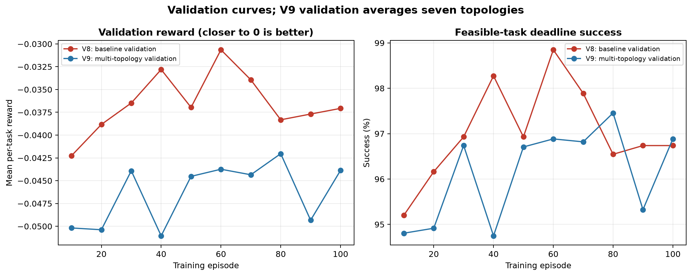
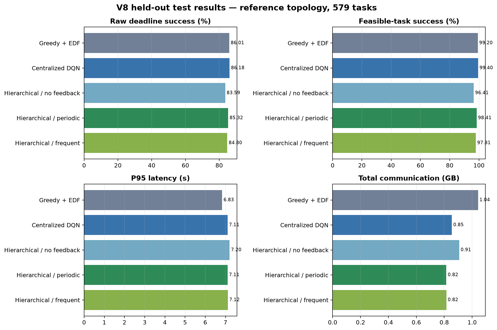
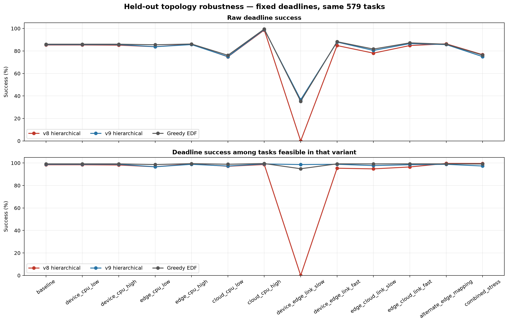
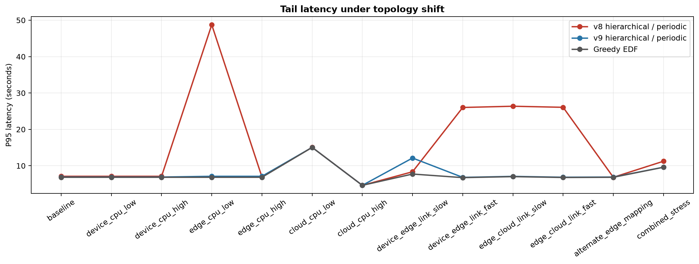

# Robustness of Hierarchical Double-DQN Task Offloading

## Abstract

**Version status:** the v8/v9 policy percentages below are historical and are
not comparable with the revised contention regime. A newer five-training-seed
feedback ablation is being run with the revised 24-device, three-edge protocol.
Its partial outputs are not pooled or presented as final findings here. See
Section 11 for its design, output locations, and completion criteria.

This report documents the Student 2 reinforcement-learning integration and the
experiments used to improve its workload and topology realism. The original
Alibaba 2017 adapter treated all instances in a parallel stage as one serial
task, producing implausibly large modeled jobs; the initial MEC configuration
also lacked a convincing device–edge–cloud capacity hierarchy. The current
experiment versions task demand as the mean completed-instance work. The
historical v8/v9 results used a three-device/two-edge/shared-cloud topology
and an explicit feasibility-aware reward, and compared a reference-trained model (v8) with a
model trained across 13 topology variants (robust v9).

On the 579-task chronological test split in the reference topology, robust v9
reaches 85.7% raw deadline success, compared with 85.3% for v8 and 86.0% for
Greedy EDF. Its largest observed improvement is under the deliberately slow
device–edge link: hierarchical periodic success rises from 0% to 36.6%; among
tasks feasible without queues in that variant, success is 98.6%. Performance is
not uniformly better: v9 falls from 76.7% to 75.0% in the combined-stress
case. These are deterministic simulator results on one trace split and one
test seed. The topology variants are the same family used in training, so this
is evidence of robustness to those known perturbations—not validation on
unseen real deployments. In the reference topology, the learned hierarchical
policy still does not beat Greedy EDF.

## 1. Research questions

1. Does replacing the erroneous parallel-stage-as-serial-task interpretation
   produce a workload that can meaningfully test routing policies?
2. How does hierarchical Double-DQN compare with centralized DQN and
   non-learning policies on the corrected reference workload?
3. Does exposing the learner to varied CPU, network, and mapping conditions
   reduce sensitivity to topology changes?
4. What do the results establish, and what remains unsupported by the
   simulator and experiment design?

## 2. System and policy architecture

The simulator processes tasks through a Device → Edge → Cloud hierarchy.
At each device, the device policy chooses local execution or offload to its
associated edge. An edge policy chooses edge execution or forwarding to Cloud.
Reported checkpoints use a fixed EDF cloud scheduler; a learned cloud policy
was not used for these results. The centralized DQN is a full-state,
three-action reference rather than a deployable hierarchy.



Each DQN uses an independent MLP with two 64-unit ReLU hidden layers. The
device network maps 11 normalized features to two Q-values; the edge network
maps 10 features to two Q-values; an optional cloud network maps 11 queue
features to three scheduling-rule Q-values; and the centralized network maps
16 full-state features to three Q-values. Features include normalized task work,
deadline/service estimates, queue and CPU state, route/link characteristics,
and delayed feedback state. The cloud has EDF in the historical reported
configuration.
The feature schema is versioned as `simpy-v9-cloud-queue-signals`; older
surrogate-model checkpoints are not interchangeable with it.

The learner is Double-DQN with an online and target network, replay capacity
8,000, batch size 32, learning rate `3e-4`, target update every 500 learning
steps, discount `0.94`, and epsilon decaying linearly from `0.90` to `0.05`
by 75% of the episode budget. Optimization uses Smooth L1 loss and gradient
clipping. Terminal credit is the default; `next-decision` optionally bootstraps
from the same agent's following logged decision with a positive discount. This
remains an episodic simulator integration rather than a Gymnasium environment,
and does not backpropagate through the simulator.

The cloud observation now includes queue length, deadline slack, estimated
workload imbalance, and the number of jobs whose slack is no greater than
their estimated cloud service time. Singleton queues are omitted from replay.
SPT ranks jobs by `estimated_work_mi`; for the Alibaba 2017 adapter this is the
documented mean completed-instance work estimate.
For contested cloud dispatches, the learner receives a negative normalized
cost for the total queue waiting incurred during the selected job's estimated
service time. This reward is separate from the shared per-task reward used by
the other tiers. The shared feedback-byte reward remains mode-dependent unless
its configured weight is zero.

## 3. Workload, topology, and reward

### 3.1 Alibaba task semantics

The workload is built from Alibaba Cluster Trace 2017 `batch_task.csv` and
`batch_instance.csv`. Of 80,553 examined task rows, 2,891 were retained and
77,662 rejected; 147,849 incomplete or rejected instance records were also
reported. The retained set is split chronologically into 1,734 training, 578
validation, and 579 test tasks.

The task demand is now
`mean((instance_end - instance_start) × real_cpu_avg × reference_mips_per_core)`
over valid completed instances. `instance_num` is the parallel instance
count—not a task-size field—so summing all instance work and then scheduling
that sum as one serial job overstated demand. The adapter version is
`alibaba2017-mean-completed-instance-lognormal-payload-v2`; checkpoints
trained against an earlier payload/task adapter must not be reused.

This remains a transformed infrastructure trace, not a complete MEC dataset.
Arrival times and derived work are trace-based. The 2017 adapter now assigns a
reproducible task-specific lognormal input payload (median 1 MB, sigma 1,
capped at 50 MB); the 0.1 MB output, 1,000 reference MIPS/core, device
assignments, deadlines, battery/radio state, and MEC capacities remain
simulation assumptions. The payload change increments the adapter version;
previous checkpoints must be retrained.

### 3.2 Reference MEC topology and deadline

The revised trace configuration has 24 devices (800/1,000/1,200 MIPS
repeated), three edges (5,000/6,250/7,500 MIPS), and one 20,000-MIPS cloud
worker. Device–edge and edge–cloud bandwidths are 100 and 1,000 Mbps,
respectively. Devices are mapped round-robin across the three edges. Historical
v8/v9 runs used `k=0.136067`, calibrated against their former test window;
those results are not a leakage-free estimate and are not the current protocol.
The revised trainer calibrates compression on all 578 chronological validation
tasks to offered load 0.75 against 12,500 MIPS, then evaluates once on the
separate chronological test split. The topology also enables seeded ±10%
bandwidth jitter and service-time noise.

Deadlines use the synthetic `best-tier-calibrated` rule:

`deadline = max(1 second, 0.9 × required_MI / fastest_configured_MIPS + 0.5 seconds)`.

The factor was selected on training data; it is not an SLA from Alibaba.
Feasibility must be recalculated for each
compressed workload and topology; the previous v8/v9 counts do not apply to
the revised payloads/topology. A separate feasibility-aware success rate is
reported alongside raw success.
Under a topology variant, deadlines stay fixed at the reference-derived values
and route feasibility is recomputed for the changed topology.

### 3.3 Reward and interpretation

The shared terminal reward is negative normalized cost:

`R = −(0.35 × latency_fraction + 0.25 × energy_fraction + 0.35 × feasible_miss + 0.05 × communication_fraction)`.

Latency is a clipped logarithmic end-to-end-latency/deadline term; device
energy is normalized by 0.3 J and capped; coordination is normalized by 64
feedback bytes and capped. Thus a 0.15 J offload contributes 0.5 to the
normalized energy fraction. The deadline-miss term applies only when at least
one route could meet the deadline with empty queues. A negative reward is
expected; higher (less negative) is better.

## 4. Revised contention calibration

The deterministic workload calibration used seed 42, the full chronological
test split (579 tasks), heterogeneous payloads, and seeded simulator noise.
`scripts/calibrate_contention.py` sweeps the requested compression factors and
adds the interpolated factor that targets offered load 0.75. At `k=0.136067`,
the oracle-state Greedy EDF reaches the requested 70–85% raw success band.
The offered-load index uses the requested 12,500-MIPS denominator; the three
configured edge CPUs sum to 18,750 MIPS, so the denominator is a reference
capacity rather than the topology's full aggregate CPU capacity.
`greedy_delayed` is the information-matched baseline: it receives only the
same causal delayed queue signals as hierarchical device/edge agents and does
not read exact edge/cloud queue state. `always_edge` is included as a load
stress control.

| Policy | Raw deadline success | Tasks with queue wait >1 s | Mean device energy (J) | Data bytes | Feedback bytes |
|---|---:|---:|---:|---:|---:|
| always_edge | 31.4% | 58.2% | 0.233 | 1,058,807,112 | 0 |
| greedy_oracle_edf | 75.6% | 12.3% | 0.211 | 1,299,097,675 | 0 |
| greedy_delayed | 67.7% | 18.7% | 0.258 | 1,171,958,482 | 7,328 |

These are calibration baselines only. The LaTeX report presents the revised
held-out policy comparisons separately. The
measured CSV is
`results/contention-calibration/contention_calibration.csv`.

The training sweep samples nine of the 13 topology variants. Four variants
(`cloud_cpu_high`, `device_edge_link_fast`, `edge_cloud_link_fast`, and
`combined_stress`) are held out for final evaluation and are not used in
checkpoint selection. Feedback modes must each be trained with at least three
seeds and evaluated with the checkpoint's own mode. The optional
`next-decision` credit ablation bootstraps from the same agent's next logged
decision with gamma 0.9; it is not the default one-step result.

## 5. Historical experiment sequence and modifications

| Phase | Change or finding | What it established |
|---|---|---|
| Early training attempts | Fixed-deadline and relative-deadline runs produced very negative, unstable rewards and extreme latency tails. | The score alone was not a useful diagnosis. |
| Workload/topology diagnosis | Found that a stage with many parallel instances was modeled as one summed serial task; cloud capacity was also configured below device/edge capacity. | The apparent RL failure was substantially a problem-definition and topology issue. |
| Corrected workload and hierarchy | Adopted mean completed-instance work, 3 devices, 2 edges, a faster shared cloud, calibrated synthetic deadlines, and feasibility-aware reward. | Replaced the degenerate task/capacity setup; prior checkpoint scores are not comparable. |
| V8 baseline | Trained/evaluated on the reference topology and tested the same 13-variant sensitivity sweep. | Exposed severe sensitivity to the slow device–edge link and one edge-CPU tail-latency case. |
| Robust v9 | Scheduled all 13 variants in seeded, shuffled, near-balanced training cycles; selected a checkpoint by mean validation reward across seven variants; reran the same held-out sweep. | Slow-link performance improved substantially, but gains were mixed across variants. |

The older pre-correction percentages and million-second latency tails are
retained only as diagnostic history. They used different task semantics and/or
deadline assumptions, and should not be plotted as a continuous learning
curve against v8/v9.

## 6. Historical training and evaluation protocol

Robust v9 was trained for 100 episodes of 200 tasks. There are 13 topology
variants; the seeded schedule contains each variant in shuffled cycles, so
each appears 7 or 8 times. Validation runs every 10 episodes on the complete
578-task chronological validation split under seven variants: baseline, low
edge CPU, low cloud CPU, slow device–edge link, slow edge–cloud link,
alternate device-to-edge mapping, and combined stress. The selected model
maximizes mean validation reward over those variants. V8 checkpoint selection
used reference-topology validation, so v8 and v9 best-validation rewards are
not directly comparable.

The test sweep evaluates Greedy EDF, centralized DQN, and hierarchical
no-feedback/periodic/frequent-feedback policies on the same 579 test tasks,
seed 10001, across all 13 topology variants. The simulator is deterministic
and ignores its seed. Since the same discrete variants are included in robust
training, the sweep measures held-out-task robustness to the tested variant
family, not performance on topology conditions never seen in training.



## 7. Historical results

### 6.1 Reference-topology policy comparison

The table below uses the v8 reference-topology held-out run. Feasible-task
success conditions on the 502 tasks classified as no-queue-feasible; raw
success uses all 579 tasks. Latencies are in seconds. The communication column
adds modeled task traffic and feedback bytes.

| Policy | Raw deadline success | Feasible-task success | Median latency | P95 latency | Mean device energy (J) | Communication (GB) |
|---|---:|---:|---:|---:|---:|---:|
| Random | 55.3% | 63.7% | 0.753 | 200.18 | 11.418 | 0.496 |
| Greedy EDF | 86.0% | 99.2% | 0.266 | 6.83 | 0.145 | 1.043 |
| Centralized DQN | 86.2% | 99.4% | 0.304 | 7.11 | 0.148 | 0.855 |
| Hierarchical, no feedback | 83.6% | 96.4% | 0.285 | 7.20 | 0.171 | 0.908 |
| Hierarchical, periodic | 85.3% | 98.4% | 0.342 | 7.11 | 0.147 | 0.815 |
| Hierarchical, frequent | 84.8% | 97.8% | 0.342 | 7.12 | 0.147 | 0.815 |

The reference results do not show a decisive RL win: centralized DQN is 0.2
percentage points above Greedy EDF in raw success, while hierarchical
periodic is 0.7 points below it. The centralized policy uses full state and
has no feedback-message cost, so it is an oracle-style benchmark rather than
an equal-information deployment comparison. Periodic feedback is better than
no feedback here, but frequent feedback does not improve the reported outcome
and carries more feedback traffic. These small differences should not be
treated as statistically significant.



### 6.2 Topology robustness: v8 versus robust v9

| Test variant | Hierarchical v8 raw success | Robust v9 raw success | Feasible-task success v8 → v9 | Hierarchical P95 latency v8 → v9 |
|---|---:|---:|---:|---:|
| Reference topology | 85.3% | 85.7% | 98.4% → 98.8% | 7.11 → 6.90 s |
| Device–edge link at 10%, propagation doubled | 0.0% | 36.6% | 0.0% → 98.6% | 8.35 → 12.13 s |
| Edge CPU at 50% | 83.8% | 83.8% | 96.6% → 96.6% | 48.75 → 7.11 s |
| Cloud CPU at 50% | 74.8% | 75.0% | 97.1% → 97.3% | 15.06 → 15.05 s |
| Combined stress | 76.7% | 75.0% | 99.6% → 97.3% | 11.25 → 9.61 s |

The slow-link result needs both success measures: only 215 of 579 tasks are
no-queue-feasible under that topology. Robust v9 succeeds on 36.6% of all
tasks, while its 98.6% feasible-task rate shows that almost all tasks that
could succeed in principle do succeed in this run. Its p95 latency is worse
than v8 in this variant, so the success improvement is not a universal
latency improvement.

Across all 13 variants, hierarchical periodic raw success ranges from 0% to
98.6% for v8 and from 36.6% to 99.1% for v9. The lower bound improves, but
combined stress regresses slightly and the reference result remains just
behind Greedy EDF (85.7% vs 86.0%). This is a mixed robustness result, not
evidence that the learned model is globally superior.





### 6.3 Validation selection

The recorded best validation rewards are `-0.0306` hierarchical and `-0.0197`
centralized for v8, versus `-0.0420` hierarchical and `-0.0282` centralized
for v9. V9's score averages seven topologies, while v8's is from the reference
topology only. The lower v9 values are therefore not evidence of regression
by themselves; the validation objectives differ.

## 8. Limitations and threats to validity

1. **Synthetic MEC fields:** Alibaba does not provide these device, radio,
   payload, edge, cloud, or deadline values. Results depend on the declared
   assumptions.
2. **Serial resource model:** SimPy has one execution slot per device/edge
   and one cloud worker. It is multi-device/multi-edge, but not a multi-core
   or multi-worker execution model; shared-network contention is not modeled.
3. **Single trace split and one test seed:** There are no independent trace
   windows or statistical intervals. Deterministic simulation does not
   eliminate training-seed or workload-sampling uncertainty.
4. **Known topology family:** The same 13 discrete variants are sampled
   during training and then swept at test time. Test tasks are held out, but
   the topology parameters are not.
5. **Heavy-tailed workload:** Tail metrics are essential; an average can hide
   extreme jobs. Deadline values are synthetic, and variant feasibility can
   differ substantially.
6. **Centralized information advantage:** The centralized policy sees the
   full state, unlike separate device/edge policies. It is a useful
   performance reference, not a fair communication-budget match.
7. **Learning formulation:** Delayed terminal credit assigns the task outcome
   to logged decisions using a one-step terminal target. This does not model
   long-horizon queue-control returns as a conventional multi-step MDP.
8. **No deployment evidence:** The sensitivity variants are hypothetical
   simulator parameters, not measurements from deployed MEC systems.

## 9. Conclusions and next experiments

The key correction was to the modeled workload, not simply the neural
network: the old adapter made a parallel stage into an oversized serial job.
After correcting that interpretation and making the topology hierarchical,
v8 established a meaningful held-out benchmark. Topology augmentation then
improved the worst observed raw-success case and repaired a large p95-tail
regression under low edge CPU, but did not make hierarchical RL better than
Greedy EDF in the reference topology or in every stress case.

The next defensible steps are: (a) evaluate multiple independent training
seeds and additional chronological trace windows; (b) reserve topology
parameter combinations—not just tasks—as a true unseen-topology test; (c)
include capacity concurrency and shared-link contention if those are part of
the target system; and (d) compare policies with matched state information
and communication budgets. Do not claim production-ready or statistically
significant gains from the present runs.

## 10. Reproducibility: historical v8/v9 runs

The full accepted local trace is required in `data/raw/`; raw data is not
committed. Commands below reproduce the documented robust training and the
same topology sweep:

```bash
python scripts/train_integrated_rl.py --source alibaba2017 \
  --deadline-policy best-tier-calibrated --topology-augmentation sweep \
  --episodes 100 --tasks 200 --max-trace-tasks 30000 \
  --validation-tasks 578 --validation-every 10 \
  --output artifacts/models/alibaba-best-tier-calibrated-topology-robust-v9

python scripts/sweep_topologies.py \
  --models artifacts/models/alibaba-best-tier-calibrated-topology-robust-v9 \
  --deadline-policy best-tier-calibrated --tasks 579 \
  --output results/alibaba-topology-sensitivity-robust-v9

python scripts/generate_rl_report_figures.py
```

The report figures are generated from the v8/v9 training logs, aggregate
metrics, and topology-sweep CSVs. Primary source artifacts are
[`v8 metadata`](../artifacts/models/alibaba-best-tier-calibrated-v8/metadata.json),
[`robust v9 metadata`](../artifacts/models/alibaba-best-tier-calibrated-topology-robust-v9/metadata.json),
[`v8 aggregate metrics`](../results/alibaba-best-tier-calibrated-v8/aggregate_metrics.csv),
[`v8 topology sweep`](../results/alibaba-topology-sensitivity-v8/topology_metrics.csv),
and
[`robust v9 topology sweep`](../results/alibaba-topology-sensitivity-robust-v9/topology_metrics.csv).

## 11. Revised feedback ablation: pending consolidation

The current campaign uses the revised trainer and trace adapter; it is a
separate experiment from the historical v8/v9 results. Its purpose is to
compare feedback policies with independently trained checkpoints and then
evaluate them on a chronologically reserved test split. No partial campaign
numbers are presented as final findings.

### 11.1 Conditions and what they test

There are six training conditions per training seed: `none`, `periodic`,
`frequent`, and `event` at thresholds 0.1, 0.25, and 0.5. Five training seeds
(42–46) therefore require 30 Double-DQN runs.

| Condition | Trigger | Interpretation |
|---|---|---|
| `none` | No feedback messages | Measures hierarchical control without inter-tier queue snapshots. |
| `periodic` | Initial snapshot, then every five channel observations | Fixed cadence in decision observations; five observations are not a fixed number of seconds. |
| `frequent` | Every observation | High-information/high-control-traffic reference. |
| `event` | Initial snapshot; signal change reaches threshold; or five-observation fallback refresh | Measures the responsiveness/communication trade-off at thresholds 0.1, 0.25, and 0.5. |

The event threshold applies to the change in the queue signal, not to deadline
success or a percentage of tasks. A lower threshold generally permits more
updates; the fallback prevents a signal from remaining stale indefinitely.
Snapshots are causal: a receiving tier cannot use one until modeled
propagation and serialization have elapsed. The simulator counts those bytes,
delay, and information age, but feedback messages do not contend with
data-plane links. The `periodic` and `event` modes both use a fallback interval
of five observations, but only the latter also triggers on signal changes.

### 11.2 Trace splits, sampling, and arrival compression

The accepted Alibaba workload has 2,891 chronologically ordered tasks:
1,734 for training, 578 for validation, and 579 for test. Task work is derived
from the mean work of valid completed instances. Payload sizes, MEC capacities,
device assignments, and deadlines remain simulator assumptions; this is not
a measured mobile-MEC workload.

Each training episode samples 100 tasks without replacement from the training
split. The sample changes with the episode seed, as do the simulator's seeded
service/bandwidth perturbations. The default samples tasks rather than taking
a contiguous chronological window. Arrival compression scales the gaps
between arrivals; it does not change task work. A factor below one brings
arrivals closer and increases offered load.

If no explicit factor is supplied, it is calibrated using validation to target
offered load 0.75 relative to 12,500 MIPS. The resulting factor is reused on
the test split without adjustment. Test data are not used to calibrate load or
select checkpoints.

### 11.3 Learners, training budget, and reward

Each agent uses a two-hidden-layer, 64-unit network; replay capacity 8,000;
batch size 32; learning rate `3e-4`; target-network update every 500
optimization steps; and Smooth L1 loss. Device and edge each have two actions,
the cloud has three scheduling-rule actions, and the centralized controller
has three actions. The centralized learner is trained with the same episode
budget and epsilon schedule, but observes global state, so it is a
performance reference rather than an equal-information comparison.

The maximum budget is 1,000 episodes × 100 tasks. Epsilon is episode-based:
it decreases linearly from 0.90 to 0.05 during the first 75% of the budget,
then stays at 0.05. Early stopping may end a run before the floor is reached.
This shared schedule avoids tying exploration to the different numbers of
decisions made by device, edge, and centralized agents.

The campaign trains the cloud agent and uses `next-decision` credit with
discount `gamma=0.9`: a decision can bootstrap from that same agent's next
logged decision. Singleton cloud queues are omitted from replay because EDF,
SPT, and FIFO select the same job there. For contested dispatches, the cloud
uses a queue-waiting-cost reward; this is distinct from the shared per-task
reward used by other tiers. The shared reward weights are 0.35 latency,
0.25 device energy, 0.35 feasible-deadline miss, and 0.05 feedback cost.
Because feedback cost differs by mode, the modes do not optimize exactly the
same reward function; this is a limitation to retain when interpreting the
ablation.

### 11.4 Topology variants

Training follows a seeded, shuffled, near-balanced schedule over nine
variants: reference; device CPU at 75% and 125%; edge CPU at 50% and 150%;
cloud CPU at 50%; device–edge bandwidth at 10% with propagation doubled;
edge–cloud bandwidth at 10% with propagation doubled; and an alternate
association swapping devices 2 and 3 between edges. The purpose is to expose
the policy to varied capacities and paths during training.

For this revised campaign, validation uses the reference topology only; it
does not select checkpoints by a topology sweep. Four variants are held out
of training and used only for evaluation: cloud CPU at 150%; device–edge
bandwidth doubled with propagation halved; edge–cloud bandwidth doubled with
propagation halved; and combined stress (all CPU capacities at 75%, both link
bandwidths at 50%, propagation doubled). These are simulated sensitivity
cases, not observed deployments or independent trace periods.

### 11.5 Validation and checkpoint selection

Every 25 episodes, each controller is evaluated greedily (no exploration or
replay updates) on the same 578 validation tasks under five noise seeds.
Hierarchical and centralized checkpoints are selected independently using
raw deadline success first and lower P95 latency as the tie-breaker. The
printed reward is diagnostic; it is not the selection metric. Patience is
eight validation checks without improvement. Training stops when both
controllers have reached that patience, or at the 1,000-episode budget.

### 11.6 Test evaluation, comparison policies, and metrics

Each checkpoint is evaluated in its own trained feedback mode and threshold,
without exploration. Each of five evaluation seeds (10001–10005) evaluates
all 579 test tasks on the reference topology and four held-out topology
variants. The evaluation seeds vary simulator perturbations, not the
chronological test window.

Comparison policies include the learned hierarchy, centralized DQN,
random, greedy placement with FIFO or EDF cloud scheduling, and a delayed
greedy policy. They help separate feedback effects from placement/scheduling
effects, but not every baseline has the same observation or learning budget.
In particular, centralized DQN has global state.

The reported measures include raw deadline success; feasible-task deadline
success (tasks that could meet the deadline on at least one route with empty
queues); median and P95 latency; device energy; task communication bytes;
feedback bytes; and feedback information age. Raw success remains the
primary all-task measure. P95 is computed per evaluation run, and information
age is accumulated when a decision consumes a delivered snapshot.

### 11.7 Aggregation and uncertainty

For each training seed, metrics are first averaged over its five evaluation
seeds. The final summary then reports the mean and sample standard deviation
of the five training-seed means. The 95% interval is a percentile bootstrap
over those five independent training-seed means, using 2,000 resamples.
Evaluation seeds therefore do not masquerade as independent training runs.
With five training seeds, intervals remain uncertain and should be treated as
descriptive rather than universal evidence.

### 11.8 Outputs and completion criteria

Checkpoints and training/decision logs are under
`artifacts/models/feedback-ablation/`; comparison results are under
`results/feedback-ablation/`. Directory names encode mode, threshold,
algorithm, training seed, and credit mode. For example,
`fb-none-threshold-0.25-double-dqn-seed-43-next-decision/aggregate_metrics.csv`
is just one training-seed condition, even if it contains five evaluation
seeds.

Do not pool results or report confidence intervals until all requested
condition/seed result files exist and the protocol/hash checks pass. After
the runs finish, create the consolidated table from the repository root:

After all runs finish, create the consolidated table from the repository root:

```powershell
.\.venv\Scripts\python.exe scripts\summarize_feedback_ablation.py `
  --results-root results\feedback-ablation `
  --feedback-modes none periodic frequent event `
  --event-thresholds 0.1 0.25 0.5 `
  --algorithms double-dqn `
  --seeds 42 43 44 45 46 `
  --credit-mode next-decision |
  Out-File results\feedback-ablation\summary.csv -Encoding utf8
```

The summary reports means, standard deviations, and bootstrap 95% confidence
intervals across training-seed means for raw deadline success, P95 latency,
device energy, communication/feedback bytes, and feedback age. Until this
summary is generated and inspected, the new campaign has no final comparative
conclusion. Replace this status with the consolidated results and their
limitations after completion; retain the historical sections above as
historical results rather than silently overwriting them.
